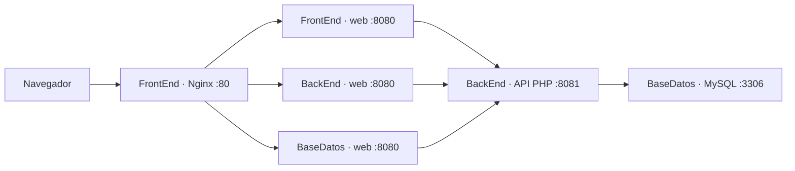

# Agenda compartida con login y balanceador Nginx

Práctica de Oracle Cloud con **tres máquinas en total**, PHP, PHP-FPM, Nginx y MySQL. Las tres VM sirven la misma agenda; Nginx reparte las peticiones entre ellas. Hay un único backend y una única base de datos. Todos los usuarios autorizados comparten los contactos y se crean desde la terminal; no existe registro público.

## Arquitectura



| Máquina | IP privada del modelo | Servicios |
|---|---|---|
| FrontEnd | `10.0.0.10` | Balanceador Nginx en 80 y web PHP en 8080 |
| BackEnd | `10.0.0.11` | API PHP en 8081 y web PHP en 8080 |
| BaseDatos | `10.0.0.12` | MySQL en 3306 y web PHP en 8080 |

Las tres pertenecen a la misma VCN. BaseDatos no necesita IP pública; el acceso SSH se hace a través de FrontEnd. Las plantillas Nginx incluyen estas IP privadas y deben adaptarse juntas si cambia la red.

Nginx utiliza **round robin**, sin afinidad por IP. La cookie identifica una sesión almacenada por el backend en MySQL; por eso el login continúa cuando la siguiente petición llega a otra web. `X-App-Instance`, `/health.php` y la etiqueta de la interfaz identifican la web que respondió. El balanceador agrega `X-Load-Balancer`.

Las webs usan el pool PHP-FPM `/run/cloud1/php-fpm.sock`. En BackEnd, la API tiene un pool propio en `/run/cloud1/php-api.sock`, generado por el instalador según el rol. Así las llamadas de la web a la API no esperan procesos del mismo pool.

## Funciones y seguridad

- Login y logout; sin login no se puede leer ni modificar la agenda.
- Búsqueda, alta, edición y eliminación de contactos compartidos.
- Contraseñas almacenadas como hashes bcrypt; consultas preparadas y salida HTML escapada.
- Sesiones centralizadas: rotación al iniciar sesión y revocación al cerrar sesión o cambiar la contraseña.
- Cookie `HttpOnly` y `SameSite=Lax`; `Secure` cuando se configura HTTPS.
- CSRF en login y escrituras. Borrar y cerrar sesión requieren POST.
- Límite de diez intentos incorrectos por usuario en quince minutos.

La sesión dura ocho horas de inactividad de forma predeterminada. `SESSION_TTL` admite entre 300 y 86400 segundos. Las webs consultan exclusivamente la API; únicamente BackEnd utiliza las credenciales de MySQL.

## Requisitos

- Tres VM Ubuntu con conectividad privada entre ellas y salida a Internet para instalar paquetes.
- PHP **8.1 o superior**, PHP-FPM y extensiones `curl`, `pdo_mysql` y `mbstring`.
- Nginx en las tres VM y MySQL en BaseDatos.
- SSH, `tar`, `rsync` y permisos `sudo` para instalar y desplegar.
- Python 3.10 o superior para las pruebas. CLI de OCI para `deploy/power.py`.

`deploy/install-node.sh` usa `apt-get`; está preparado para Ubuntu.

## Archivos principales

```text
login.php, logout.php       Inicio y cierre de sesión
index.php                  Agenda compartida y búsqueda
agregar.php, editar.php     Formularios de contactos
eliminar.php               Borrado mediante POST
health.php                 Salud de web, API y base
api/index.php              API central de autenticación y contactos
includes/app.php           Cliente de API, cookie y protección de páginas
includes/backend.php       Sesiones y operaciones del backend
config.example.php         Ejemplo público sin credenciales
config.local.php           Configuración privada de cada VM, fuera de Git
database/schema.sql        Tablas; preserva los contactos existentes
database/agenda.sql        Instalación con el cliente mysql
scripts/init-db.php        Migración alternativa por PHP CLI
scripts/crear-usuario.php   Creación de usuarios y cambio de contraseña
deploy/nginx/              Plantillas de web, API y balanceador
deploy/install-node.sh     Instalación de paquetes y configuración por roles
deploy/sync.sh             Actualización del código sin borrar archivos
deploy/power.py            Encendido y apagado manual de las tres VM
tests/                     Pruebas HTTP del login, CRUD y balanceador
```

## Configuración privada

Trabajar desde la raíz del repositorio. `.local/`, `config.local.php`, `.env`, claves y certificados privados están excluidos de Git. Crear una configuración por máquina a partir de `config.example.php`:

```bash
mkdir -p .local
chmod 700 .local
cp config.example.php .local/config-FrontEnd.php
cp config.example.php .local/config-BackEnd.php
cp config.example.php .local/config-BaseDatos.php
chmod 600 .local/config-*.php
```

Completar los archivos con un editor local. No hay contraseña ni clave de API predeterminadas.

| Clave | Configuración |
|---|---|
| `APP_INSTANCE` | `FrontEnd`, `BackEnd` o `BaseDatos`, según la web |
| `API_URL` | `http://10.0.0.11:8081/api/index.php` en las tres VM |
| `API_KEY` | El mismo secreto aleatorio, de al menos 32 caracteres, en las tres VM |
| `SESSION_COOKIE` | `agenda_session`, igual en las tres VM |
| `SESSION_TTL` | `28800`, o la misma duración elegida para todas |
| `COOKIE_SECURE` | `false` para este laboratorio HTTP; `true` con HTTPS |
| `DB_HOST`, `DB_PORT` | `10.0.0.12` y `3306`, solo en BackEnd |
| `DB_NAME`, `DB_USER`, `DB_PASS` | Base, usuario y contraseña elegidos fuera de Git, solo en BackEnd |
| `DB_SSL_CA` | Opcional: `/etc/cloud1/mysql-ca.pem`, solo en BackEnd; obliga a utilizar TLS verificado |

Cada archivo devuelve un array PHP. En el servidor se instala como `/var/www/cloud1/config.local.php`, con propietario `root:www-data` y modo `0640`. Las variables de entorno tienen prioridad, pero PHP-FPM usa `clear_env = yes`; el servicio web obtiene la configuración del archivo privado.

## SSH y reglas de red

Guardar los alias `cloud1-front`, `cloud1-backend` y `cloud1-db` en `.local/ssh-config`, con sus destinos y claves privadas locales. Mantener el archivo y las claves con modo `0600`.

```bash
SSH_CONFIG="$PWD/.local/ssh-config"
ssh -F "$SSH_CONFIG" cloud1-front hostname
ssh -F "$SSH_CONFIG" cloud1-backend hostname
ssh -F "$SSH_CONFIG" cloud1-db hostname
```

BaseDatos usa `10.0.0.12` como destino y FrontEnd como salto. Si se utiliza `ProxyCommand`, su llamada interna a SSH también debe indicar `-F` y entrecomillar la ruta absoluta; esto es necesario cuando el directorio contiene espacios:

```sshconfig
ProxyCommand ssh -F "/ruta absoluta/Cloud-1/.local/ssh-config" -W %h:%p cloud1-front
```

Permitir el tráfico en OCI y, si está activo, en el firewall de Ubuntu:

| Destino | Origen permitido | Puerto TCP |
|---|---|---|
| FrontEnd, balanceador | Navegadores de la práctica | 80 |
| Las tres webs | `10.0.0.10` | 8080 |
| BackEnd, API | `10.0.0.10`, `10.0.0.11`, `10.0.0.12` | 8081 |
| BaseDatos, MySQL | `10.0.0.11` | 3306 |
| FrontEnd y BackEnd, SSH | Equipo de administración | 22 |
| BaseDatos, SSH | `10.0.0.10` | 22 |

La API, MySQL y las webs de 8080 no se publican en Internet. El instalador añade reglas cuando UFW ya está activo; las reglas de OCI se gestionan aparte. BaseDatos necesita una ruta de salida por NAT para instalar paquetes si carece de IP pública.

## Instalación en las tres VM

Copiar el código a una carpeta de instalación, conservando la configuración privada fuera del paquete. Estos comandos aceptan rutas locales con espacios y no borran archivos remotos:

```bash
SSH_CONFIG="$PWD/.local/ssh-config"
for HOST in cloud1-front cloud1-backend cloud1-db; do
    tar --exclude=.git --exclude=.local --exclude=.env \
        --exclude=config.local.php --exclude='*.key' --exclude='*.pem' \
        -cf - . | ssh -F "$SSH_CONFIG" "$HOST" \
        'mkdir -p ~/cloud1-src && tar -xf - -C ~/cloud1-src'
done

for PAIR in FrontEnd:cloud1-front BackEnd:cloud1-backend BaseDatos:cloud1-db; do
    NODE=${PAIR%%:*}
    HOST=${PAIR#*:}
    ssh -F "$SSH_CONFIG" "$HOST" \
        'umask 077; cat > ~/cloud1-src/config.local.php' \
        < ".local/config-$NODE.php"
done

ssh -F "$SSH_CONFIG" cloud1-front \
    'cd ~/cloud1-src && sudo bash deploy/install-node.sh FrontEnd 10.0.0.10 web,balancer'
ssh -F "$SSH_CONFIG" cloud1-backend \
    'cd ~/cloud1-src && sudo bash deploy/install-node.sh BackEnd 10.0.0.11 web,backend'
ssh -F "$SSH_CONFIG" cloud1-db \
    'cd ~/cloud1-src && sudo bash deploy/install-node.sh BaseDatos 10.0.0.12 web,database'
```

El instalador crea el pool PHP-FPM, instala las plantillas Nginx por rol y ejecuta `nginx -t` antes de recargar. Guarda respaldos en `/var/backups/cloud1/`. No inicializa la base, no crea credenciales y no elimina datos. Si Apache ya utiliza el puerto 80 de FrontEnd, resolver ese conflicto antes de activar el balanceador.

Si todos los paquetes necesarios ya están instalados, se puede repetir únicamente la configuración con `sudo env CLOUD1_SKIP_PACKAGES=1 bash deploy/install-node.sh ...`, conservando los argumentos de la máquina correspondiente. Esta opción omite `apt-get`, por ejemplo para evitar una espera durante actualizaciones automáticas; no sustituye la instalación inicial de los paquetes.

### Base de datos sin perder los contactos

En BaseDatos, configurar MySQL para escuchar en `10.0.0.12`, por ejemplo mediante un archivo propio en `/etc/mysql/mysql.conf.d/`, y reiniciar MySQL. Verificar que el firewall solo acepta a BackEnd en 3306.

El despliegue existente conserva `require_secure_transport=ON` en MySQL. Configurar su certificado y clave en BaseDatos; el certificado debe incluir **SAN `IP:10.0.0.12`** y estar firmado por una CA confiable. Copiar únicamente el certificado público de esa CA a `/etc/cloud1/mysql-ca.pem` en BackEnd y definir `DB_SSL_CA` en su configuración privada. El archivo debe ser legible por PHP-FPM y los comandos CLI. La clave privada de la CA y la clave privada del servidor MySQL permanecen en sus destinos protegidos; no se copian al backend ni al repositorio.

Cuando `DB_SSL_CA` está configurado, PDO exige una CA existente y legible, verifica el certificado del servidor y comprueba que la conexión negoció un cifrado TLS. Una CA incorrecta, una identidad de servidor distinta o una conexión sin TLS producen un fallo; no se permite continuar con una conexión sin verificar. Si MySQL exige transporte seguro, la configuración TLS de BackEnd es necesaria aunque la opción sea opcional para otros entornos.

La migración crea `contactos`, `usuarios`, `sesiones` e `intentos_login` con `CREATE TABLE IF NOT EXISTS`. Conserva los contactos existentes y no inserta datos ni credenciales de ejemplo. Para una instalación nueva o para agregar las tablas de login a la base `agenda` existente:

```bash
ssh -F "$SSH_CONFIG" cloud1-db \
    'cd /var/www/cloud1 && sudo mysql < database/agenda.sql'
```

Ejecutar desde la raíz del repositorio es necesario porque `agenda.sql` importa `database/schema.sql` mediante `SOURCE`. Si hay datos existentes, respaldarlos antes de la migración. La migración no transforma automáticamente tablas personalizadas ni copia información de otra base; no altera otras bases que coexistan en el servidor.

Como administrador de MySQL, aprovisionar fuera de Git el usuario de aplicación, autorizado exclusivamente desde `10.0.0.11`, con permisos `SELECT`, `INSERT`, `UPDATE` y `DELETE` sobre `agenda`. Guardar la misma contraseña únicamente en la configuración privada de BackEnd. La cuenta de aplicación no necesita privilegios administrativos.

También puede ejecutarse `php scripts/init-db.php` en BackEnd si la base ya existe y la conexión configurada dispone temporalmente de permisos para crear tablas y sus referencias. Después de migrar, conservar únicamente los permisos de operación de la aplicación.

### Crear el usuario del login

Ejecutar en BackEnd después de la migración. El nombre acepta de 3 a 64 letras minúsculas, números, puntos, guiones y guiones bajos. La contraseña debe tener entre 12 y 72 bytes. El script recibe la contraseña por entrada estándar o mediante `USER_PASSWORD`; no la acepta como argumento.

Ejemplo desde el equipo de administración, con entrada oculta y sin guardar la contraseña en el historial:

```bash
python3 -c 'import getpass; print(getpass.getpass("Contraseña del nuevo usuario: "))' \
    | ssh -F "$SSH_CONFIG" cloud1-backend \
      'cd /var/www/cloud1 && sudo php scripts/crear-usuario.php alumno'
```

Para cambiar la contraseña de un usuario existente, repetir el comando agregando `--update-password` después del nombre. Esto revoca sus sesiones anteriores y elimina el bloqueo por intentos fallidos. No existe un formulario web de registro.

Abrir la dirección pública de FrontEnd para iniciar sesión. `/agenda/` redirige a la raíz para mantener compatible la URL de la práctica original.

## Sincronizar cambios

```bash
bash deploy/sync.sh cloud1-front cloud1-backend cloud1-db
```

El script usa por defecto `.local/ssh-config`; puede sustituirse mediante la variable `SSH_CONFIG`. Su llamada a SSH y el transporte de rsync aceptan rutas con espacios.

La sincronización conserva archivos remotos y excluye `.git`, `.local`, `.env`, `config.local.php`, claves y certificados privados. No utiliza `--delete`. La configuración y las credenciales se transfieren aparte, solo cuando deban cambiar.

Sincronizar PHP y CSS no requiere reiniciar MySQL. Si cambian las plantillas Nginx, volver a aplicarlas por rol y verificar `sudo nginx -t` antes de recargar. Los respaldos de instalación contienen configuración privada; deben permanecer en el servidor con acceso administrativo.

## Comprobar el balanceador y el login

Configurar la URL pública del balanceador en el equipo de prueba; sustituir el marcador del ejemplo:

```bash
export AGENDA_BASE_URL='http://IP_PUBLICA_DEL_BALANCEADOR'
python3 tests/smoke_balancer.py --expect FrontEnd BackEnd BaseDatos
```

La prueba exige las tres webs tanto en el login como en `/health.php`, y comprueba la salud de API y MySQL. No modifica contactos. También puede observarse la cabecera manualmente:

```bash
for N in 1 2 3 4 5 6; do
    curl -sS -D - -o /dev/null "$AGENDA_BASE_URL/login.php" \
        | sed -n '/^[Xx]-App-Instance:/p'
done
```

Para comprobar una misma sesión entre las tres webs:

```bash
export AGENDATEST_USER='alumno'
export AGENDATEST_PASSWORD="$(python3 -c 'import getpass; print(getpass.getpass("Contraseña de prueba: "))')"
python3 tests/test_login.py --read-only
```

Para verificar además CSRF y el CRUD compartido:

```bash
python3 tests/test_login.py
```

La segunda prueba crea, edita y elimina exclusivamente su contacto temporal. Ambas comprueban que un login incorrecto falla, que la sesión continúa entre las webs y que logout invalida la cookie anterior. Más detalles en [tests/README.md](tests/README.md).

### Demostrar la caída de una web

Detener **solo Nginx en BaseDatos**. MySQL debe seguir funcionando; detener la VM completa haría caer la base central.

```bash
ssh -F "$SSH_CONFIG" cloud1-db 'sudo systemctl stop nginx'
python3 tests/smoke_balancer.py --expected-instances 2 --expect FrontEnd BackEnd
python3 tests/test_login.py --read-only --expected-instances 2
ssh -F "$SSH_CONFIG" cloud1-db 'sudo systemctl start nginx'
python3 tests/smoke_balancer.py --expect FrontEnd BackEnd BaseDatos
unset AGENDATEST_PASSWORD
```

Restaurar Nginx aunque alguna prueba falle. El balanceador detecta conexiones fallidas y deja temporalmente de usar esa web; las lecturas pueden pasar a otra. Nginx no repite un POST ya enviado para evitar duplicar una escritura cuyo resultado sea incierto.

## HTTP, HTTPS y límites de la práctica

La configuración incluida publica HTTP para el laboratorio, con `COOKIE_SECURE=false`. Para utilizar HTTPS, instalar un certificado válido en FrontEnd, configurar TLS en Nginx, redirigir HTTP a HTTPS y definir `COOKIE_SECURE=true` en las tres configuraciones privadas. El balanceador envía `X-Forwarded-Proto`; `COOKIE_SECURE` asegura que la cookie solo viaje mediante HTTPS.

El balanceador mejora la disponibilidad de las **webs**. FrontEnd como balanceador, BackEnd como API y BaseDatos como MySQL siguen siendo puntos únicos de falla. Una caída completa de cualquiera de esos servicios centrales puede impedir el login y la agenda, aunque queden webs encendidas.

## Créditos de Oracle y apagado manual

Las VM `VM.Standard.E5.Flex` de esta práctica **consumen créditos de la prueba gratuita** y no son recursos Always Free. Revisar el saldo y vencimiento en Oracle; conservar las VM encendidas después de una actualización a cuenta de pago puede generar cargos. [Información oficial de Oracle Free Tier](https://www.oracle.com/cloud/free/).

`deploy/power.py` actúa exclusivamente sobre las tres máquinas registradas en `.local/instances.json`; usar `deploy/instances.example.json` como referencia y guardar los identificadores reales fuera de Git. Requiere la CLI de OCI y el perfil local configurado. No hay automatización de apagado.

Al terminar la práctica, apagar manualmente las tres VM de forma ordenada:

```bash
python3 deploy/power.py SOFTSTOP
```

Para otra sesión:

```bash
python3 deploy/power.py START
```

El script imprime el estado devuelto por OCI; puede ser transitorio. Esperar a que las VM estén detenidas o ejecutándose según la acción y repetir la prueba de salud después de encenderlas. Apagar las VM reduce el consumo de cómputo; revisar también los discos y otros recursos conservados al finalizar la prueba.
